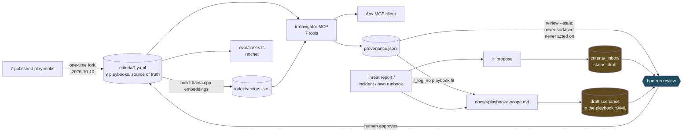

# IR Navigator — Spec

**Status:** as-built, 2026-10-31 (v2.4 — v2 amended to match the live source; review gate hardened 2026-10-11; log hygiene and eval 2026-10-25; distillation loop recorded and hunt-library import removed 2026-10-31)
**Scope:** v1 only. Deferred items named in § Out of scope.

## What this is for (2026-10-31)

ir-navigator is a workbench for distilling incident-response playbooks from
real incidents and public threat reporting. A playbook is a set of scenarios,
each with indicators and a discriminator, and the judgment criteria and hunts
for each stage. The MCP server serves that corpus to an analyst mid-incident
and logs every delivery, and that serving loop is how the corpus is tested:
a logged decision that says "no playbook fit" is the signal that starts the
next distillation. The method is [`distilling-playbooks.md`](distilling-playbooks.md);
delta 10 below records the first full run.

Two things built along the way are deliberately not the product. Credential
redaction of the delivery log is a provenance detail with its own page
([`redaction.md`](redaction.md)); it took six review rounds and the record of
that is delta 9, kept short. A hunt-library import was tried as a second
source of drafts and removed; delta 10 records what it measured.

## As-built deltas (2026-10-10, discovered at build time)

The v2 spec was drafted against a Sep-28 snapshot of the playbooks. The live
playbooks repo had already moved; four premises below were corrected during
the build (items 5–7 are later design changes, not corrected premises), by the
author's call ("fork into own criteria schema"):

1. **The HTML migration premise was dead.** `playbook-data/*.yaml` was already
   the source of truth for the Hunt & Act panels (rendered to HTML by
   `pnpm playbooks:build`, drift-guarded by jest). The migration became a
   **one-time YAML→YAML fork** of hunts/acts plus HTML extraction for the one
   slice still fused into pages: scenario cards and IR steps. The fork is
   deliberate: ir-navigator's corpus evolves independently (lifecycle fields,
   promotions) and does not write to the published artifact.
2. **Seven playbooks, not six** (`cloud-incident-response` is new, AWS/Azure/GCP
   platforms), stages run 1–10 per playbook, and the corpus was **392 criteria /
   30 scenarios / 48 steps / 176 actions** — not 246/20/67/112. "zero
   scenario-card playbooks" held: `bec-response` and `device-code-response`.
3. **MITRE is already there.** Every hunt carries mandatory `attack:` technique
   ids upstream; decision #4's "246 hand-mappings" premise is obsolete. The
   `attack` field is populated from migration day one. Hunts also carry `how`
   (operator note), `fp` (tuning note) and `tested` (ISO date the query last
   ran in a real tenant — all null today); `ir_hunt.verified` mirrors `tested`.
4. **Embeddings come from a llama.cpp host, not local Ollama** (`nomic-embed-text`,
   768-dim, llama.cpp `/v1/embeddings` at `IRNAV_EMBED_URL`, no default —
   fail-loud). Corpus vectors are committed; the query vector is fetched at
   call time, degrading to exact-term ranking with `semantic_ranking: false`
   when the host is unreachable.

5. **`ir_hunt` is a brief, keyed on scenario.** Per the hunt-scope doctrine:
   a hunt is a standing brief for a class of threat,
   not a stage-indexed query list. `ir_hunt` now takes the `playbook` and
   `scenario` an `ir_classify` candidate returned and composes the brief at
   emit time: threat model from the scenario (indicators, discriminator,
   attack), scope (platforms, stages, `time_window` from a new nullable
   scenario field `window`), every active criterion in the playbook ordered by
   stage as investigation steps, the competing scenarios as `alternatives`, and
   an output contract (confidence, supporting criteria ids, enrichment trail,
   routing ∈ `analyst_review` / `tracked_observation` / `ruled_out`) recorded
   via `ir_log`. Stages are not trimmed by scenario — the discriminator says
   where to look; the brief does not pre-decide it. Playbooks with no scenario
   branches still brief, with `threat_model: null` and a note saying so.
   `window` is outside the embedded text, so the index hash is unchanged.
6. **Detection coverage comes from a committed snapshot, not a live call.**
   `bun run build:coverage` asks the Security Detections MCP (streamable HTTP,
   basic auth, `IRNAV_DETECTIONS_URL` + `IRNAV_DETECTIONS_AUTH`, no defaults)
   which rule formats cover which techniques and how many rules carry each
   corpus technique id, and writes `index/coverage.json`. `ir_hunt` reads it:
   the stage map names the gaps and unknown techniques per stage, a stage brief details each
   technique (count, formats, covered sub-techniques). A parent id counts as
   covered when only its sub-techniques have rules — exact-id matching alone
   would report false gaps. The build keeps only T-ids from the remote layers and
   refuses an empty layer or a format count above the total, so a partial or
   hostile answer fails instead of becoming false gaps. Reading a snapshot keeps the server on local
   content only (§ Prompt-injection posture). Unlike the vector index the
   snapshot is optional: absent, every brief says coverage is unavailable;
   stale, the techniques it predates are reported `unknown`, never as gaps.
   The counts are public rules that exist, not rules deployed or tested in a
   tenant, and every coverage block says so.
7. **The review gate is the injection boundary, and it was hardened as one
   (2026-10-11).** Drafts are written by an AI client that may have read a
   hostile threat report, so `bun run review` treats draft text as
   adversarial: the reviewer must approve exactly what will be served, and
   nothing in a draft may alter the terminal or the listing around it. The
   contract is in § Keeping it current → *What review guarantees*.

8. **Log hygiene, outcome labels and a ranking eval (2026-10-25).** Taken from
   a source review of an agentic bug-bounty toolkit. The ideas came from it,
   and so did its mistakes, which are named here so they are not repeated.
   - *Provenance rows* carry `schema_version: 2`. Arguments and error text are
     credential-redacted before the write (`src/redact.ts`: secrets only;
     emails, UPNs, IPs and key ids are the evidence joins need; delta 9 has
     the rules as they stand). The log is created 0600 and an existing one is
     set to 0600 on every write. Refused calls are logged with `error`, because a client
     probing with unknown ids is a signal. Oversized calls are still refused
     before anything is logged. The log is opened the way inbox files are
     (2026-10-31: `O_NOFOLLOW`, `O_NONBLOCK`, fstat'd as a regular file): a
     symlink planted at the path is not followed, a FIFO or a directory is
     refused, the mode is set on the open handle, and the row is written
     whole on it. A file opened for writing must also have one name, so a
     planted hard link is refused; that check is on the inode after the open,
     so a link swapped in and out between the open and the check gets past
     it. The log directory is the trust boundary: a process that can write it
     can already write any file the server's user can, and these guards stop
     a planted file from redirecting a row, not a same-user attacker. A
     delivery whose row is refused fails rather than go unlogged. `review
     --stale` reads the log through the same handle (reads are not subject to
     the one-name check), refuses one over 64 MiB with a note to rotate it,
     and says when there is no log at all, since an absent log would
     otherwise read as every criterion never surfaced.
   - *Unknown arguments throw.* The SDK does not enforce
     `additionalProperties: false`, and a live row had carried an unread
     `decided_by` key.
   - *`case_id` on every tool*, so one incident's deliveries and decisions
     join on it rather than on time adjacency.
   - *`ir_log` gains `outcomes`* (per criterion: `met` / `not_met` /
     `inconclusive` / `not_evaluable`). *`not_evaluable` is a routing*:
     "could not check" must not read as "checked, negative". `ruled_out`
     requires a `falsifier` and a target.
   - *`review --stale`* also lists criteria surfaced 3+ times and never cited,
     mostly `not_evaluable`, or never `met` when evaluable. These are counts
     for the human; outcome history is deliberately **not** fed into ranking,
     which would boost common readings and bury the rare one (invariant 1).
   - *`bun run eval`* measures `ir_classify` on labelled cases. The exact arm
     gates `bun test` as a ratchet against `eval/baseline.json`; the hybrid
     arm needs the embedding host and runs by hand. First measured 2026-10-25
     on 32 cases (exact 0.84 / 0.94 / 1.00 / 0.91, hybrid 0.97 / 0.97 / 1.00 /
     0.98). The baseline at 40 cases, after the eight edge cases were added
     (the committed one is now 46 cases, with the six Kubernetes cases: exact
     0.80 / 0.91 / 0.98 / 0.88, hybrid 0.85 / 0.96 / 1.00 / 0.91):
     | arm | top-1 | recall@2 | recall@8 | MRR |
     |---|---|---|---|---|
     | exact | 0.80 | 0.90 | 0.975 | 0.87 |
     | hybrid | 0.825 | 0.95 | 1.00 | 0.90 |
     The drop is the new playbook's cases, not a regression on the old ones:
     the three exact-arm cases outside the top two that are new are all edge
     cases, and the one older miss (the AiTM inbox-rule case) was outside the
     top two at every earlier baseline. The ratchet checks per-case membership
     of the top two as well as the aggregate.
   - Rejected: a learned ranker over outcomes, an autonomy dial, auto-picking
     the next lead, and an `approve` argument. ir-navigator executes nothing,
     so an approve flag would only suggest that it can.
9. **Redaction fails closed on ambiguous input (2026-10-26).** Six review loops
   on `src/redact.ts` showed that every exemption meant to keep a look-alike as
   evidence leaked a real secret on the next round, so ambiguous strings are
   redacted and redacting evidence is accepted as the cost. A seeded property
   fuzz holds this. Rules and known limits: [`redaction.md`](redaction.md).
   Rows written before a rule change are not rewritten. This is the whole of
   what the spec has to say about it; the delivery log is a side channel, not
   the product.

10. **The distillation loop ran end to end, and the hunt-library import was
    removed (2026-10-26 to 2026-10-31).** Decision #1 forked the corpus from the
    published playbooks; § Keeping it current said new threat knowledge would
    arrive as drafts through `ir_propose`. What actually grew the corpus was a
    method, not a tool, and it is now written down in
    [`distilling-playbooks.md`](distilling-playbooks.md):
    - *The gap is found by the serving loop.* Two of the first eleven `ir_log`
      decisions said the evidence matched no playbook (an Ivanti Connect
      Secure case and a PHP web-app case). `ir_classify` on summaries of
      those cases scored every reading in a flat 0.24–0.29 band, led by a
      ransomware scenario whose discriminator asks about an extortion claim.
      That is the shape of a missing reading, and it is the trigger.
    - *A scope doc comes before any YAML.* Signals, boundary with the existing
      playbooks, platforms, a stage ladder, scenarios with discriminators,
      candidate criteria each tagged with a source, and what no source covers
      yet. [`edge-exploitation-scope.md`](edge-exploitation-scope.md) is the
      first; [`targeted-intrusion-scope.md`](targeted-intrusion-scope.md) is
      the second, scoped and not yet drafted.
    - *Scenarios are lifecycle records too.* They are authored as
      `status: draft` in the playbook file, loaded and validated, and served
      only when flipped to `active`. BEC and device-code carry eleven drafts;
      the edge playbook's five went active with its nine criteria.
    - *Sources are the provenance.* 392 criteria carry
      `landing-page@2026-10-10`; 42 carry a report, advisory, case id or
      runbook reference. The corpus is 9 playbooks, 434 criteria, 43 served
      scenarios, 56 steps, 187 actions. The edge playbook has no steps or
      actions yet.
    - *Eval cases are written from the gap cases.* The cases that showed the
      gap became the first eval cases for the playbook (eight of the 40).
    - *Hunt-library import, measured and removed.* A CLI (`src/hub.ts`, 682
      lines plus a 687-line suite, committed 2026-10-25 and last changed
      2026-10-30) read a local clone of a public library of machine-drafted
      hunts, matched them to playbooks on title keywords, and wrote one draft
      per blind spot and per query through the `ir_propose` writer. Its page
      dated the survey 2026-10-15, on 282 hunts: every one campaign-specific
      and schema-checked only, 17 drafted from product posts; 26 of 35
      identity-breach matches shared no technique with the playbook. Eighteen
      bec-response drafts it wrote were rejected on 2026-10-26 and no
      imported draft was ever promoted. The hypothesis was
      that a hunt library is a source of criteria; it is a source of reports,
      and reports are what the method above consumes. Removed on 2026-10-31
      with its test suite, doc page, `hub` script and `safe-read.ts` helper.
      `review --reject` and its `rejected.jsonl` record, written so re-runs
      would skip a rejected draft, stay as the way to decline a draft on the
      record.
    - *Negation in exact-term ranking (2026-10-30).* `ir_classify` no longer
      matches a term the evidence negates ("nothing is encrypted" does not
      score the encryption scenario). Needed because the gap cases are
      written as an analyst writes them, with what was not seen.

Counts below this line reflect the v2 draft and are superseded by the numbers
above; the design decisions and invariants stand.

## Problem

During an incident the analyst has evidence and needs the *criterion* that says
what the evidence means and what would rule the reading out. That content exists
— 246 authored `pf-why` judgment criteria across six response playbooks — but it
is fused into presentation HTML: checklist content and reference-appendix content in one artifact
with no way to extract the part you actually run.

## What this is not

Not an agent that decides, recommends containment, or acts. Measured reason
(as summarised from the papers, not independently re-verified): arXiv
2601.21083 found one frontier model logged containment actions in 100% of
adversarially-tainted IR episodes at an 82.5% false-positive rate, acting as
early as step 4, calibration below 55% across all models tested.

Support for the chosen framing, same inventory: arXiv 2511.13860, RCT, n=167
analysts — 6.5x true-positives-per-analyst-minute, 77% F1 gain, of which **83%
came from queue prioritisation, not verdict quality**. The gain is in reaching
the right question at the right moment, not in answering it for the analyst.

## The risk the design must defeat

Removing the actuator moves the calibration problem rather than removing it.
"Acting at step 4" becomes "anchoring at step 4" — one confidently surfaced
branch at minute three steers the investigation, the human owns the outcome, and
nothing records what the system showed them. Two invariants follow:

1. **Never surface one reading.** `ir_classify` returns ≥2 ranked candidates
   with their discriminators. A tool that can return one is an anchoring machine.
2. **Log every delivery.** What was surfaced — the individual criterion and
   scenario ids, not counts — when, on what input. Otherwise there is no audit
   trail and no corpus to calibrate against later: every question the outbound
   loop asks is a join on ids.

Sinno's "playbook blind" is the third: smoothly handing the next
step makes "did the five steps, we're done" *more* likely. Mitigation — every
criterion travels with its falsifier, and adjacent stages are always included so
the stage call stays open.

## Four design decisions, and what they replace

The first design extracted the HTML into JSON at build time and guarded the
coupling with a source hash. That hugged the existing artifact. Each change
below is a correction of that bias.

**1. YAML is the source of truth; HTML extraction is a one-time migration.**
Reversing the direction deletes the entire coupling layer — no build-time
regex, no entity decoding in the serving path, no HTML/JSON drift guard, because
after migration nothing reads the HTML. The criteria become directly editable
and reviewable as data, which is also what makes the two playbooks with no
scenario branches *authorable* rather than blocked. The migration script is run
once over all six playbooks and then deleted.

*Known debt:* the published playbook HTML is not updated by this and becomes a
stale rendered view. Generating HTML back out of the YAML is the follow-up that
closes it. Until then, editing a criterion does not change the published
playbook. That is a real cost, and whether to close it is a decision about the
published artifact, not one this build makes.

**2. The criterion is the atomic unit; playbook is a tag, not a container.**
The six-playbook split is a content-authoring taxonomy, not an evidence
taxonomy. In a live incident you do not yet know which playbook applies —
"scheduled task running encoded PowerShell" is relevant to ransomware,
supply-chain and identity-breach at once. Requiring the caller to pick a
playbook first inverts the actual workflow. Classification is therefore global
across all 20 scenarios and all 246 criteria, with playbook available as a
filter. This also dissolves the `bec-response` / `device-code-response`
zero-scenario problem: global ranking does not need per-playbook coverage.

**3. Hybrid retrieval: exact-token plus local embeddings.** Token overlap alone
fails on the normal case — an analyst types "ransom note" against indicators
reading "ransom notes appearing." Embeddings alone blur exactly the terms where
an exact match is the strongest signal (tool names, process names, file
extensions). Neither wins alone; correlation work needs a hybrid. Corpus vectors are computed at build time
against the local Ollama already running on this machine (`mxbai-embed-large`,
1024-dim, verified reachable 2026-10-10), so there is no new infrastructure and
the server reads a committed index. The free-text *query* still needs one
embedding call at query time, so Ollama is a **soft runtime dependency**: when
it is unreachable, ranking degrades to exact-term only and every response says
so (`semantic_ranking: false`) rather than failing the call or hiding the loss.

**4. MITRE is a schema slot, not the v1 spine.** The usual advice is to map
ATT&CK as a correlation join key, not a label — which argues for a MITRE spine
over the ransomware-specific `Stage 2 Foothold … Stage 9 Encryption` numbering
that does not align across playbooks. But the playbooks contain **zero** ATT&CK
technique IDs (verified: 0 `T1xxx` matches, 0 `attack.mitre.org` references
across the three largest). A MITRE spine is therefore 246 hand-mappings, not a
migration. The schema carries an `attack: []` field on every criterion and
scenario so the join key can be filled incrementally; the authored stage label
stays the v1 index.

**5. Every criterion carries lifecycle fields from the first migration.**
`status`, `source`, `validated_at`, `supersedes` go in before the 246 entries
exist, because adding them afterwards means touching every hand-edited record.
The vocabulary is `draft` / `active` / `superseded` / `archived`: draft is
agent-written, active is human-approved.

This is also the answer to detection decay, per the
detection-lifecycle argument that content should be treated as time-bounded
artifacts rather than permanent fixtures — "today it's this threat, tomorrow
it's the other threat." A corpus with no `validated_at` cannot tell you which
of its 246 criteria nobody has looked at since migration.

## Keeping it current

Two distinct update paths, one write mechanism.

**Inbound — new threat knowledge becomes criteria.** A threat report, advisory
or incident finding produces a *draft* criterion. Any authoring tool (a
detection-engineering skill, a CTI-validation agent, a human) is the on-ramp;
this spec only defines where its output lands. The target shape — scope +
threat model + judgment criteria + output, with threat model and risk criteria
as first-class fields — is what the `Criterion` schema already satisfies. How
a whole playbook is distilled, from the gap signal to the eval cases, is
[`distilling-playbooks.md`](distilling-playbooks.md) (delta 10).

**Outbound — the provenance log says what is working.** Every delivery is
logged, so the corpus can be asked questions it currently cannot answer: which
criteria have been surfaced and never acted on, which were surfaced immediately
before a decision that contradicted them, which have never been surfaced at all.
That is the feedback loop most IR programmes lack: investigation conclusions
feeding back into detection logic, as Tevet frames it.

**Why the loop comes before the firehose.** A knowledge base that captures
without a mechanism that consumes fills with entries nobody enforces or
revisits. Pouring new criteria into a corpus that
cannot distinguish useful from noise reproduces that exactly. Lifecycle fields
and the review path ship with v1; the CTI ingest pipeline sits on top of them.

**One write path: the draft inbox.** `ir_propose` writes only to
`criteria/_inbox/`, never into a served playbook file. Drafts are never returned
by any read tool. A `bun run review` CLI lists drafts, shows them, and promotes
approved ones into the owning playbook file.

The isolation is a blast-radius decision, not bookkeeping. `ir_propose` is a
write tool sharing a surface with read tools, which is the risk class of
adversary-authored case content entering context beside write
capability. Confining it to an inbox that nothing serves means a successful
injection produces a file awaiting human review, not a criterion an analyst
gets handed mid-incident.

**What `ir_propose` writes.** One YAML file per draft, `status: draft`, named
`<timestamp>-<slug>-<random tag>.yaml` and created exclusively (`wx`), so two
concurrent proposals never overwrite each other. The slug comes from the title,
capped at 80 characters; a title with no Latin letters or digits gets
`untitled-<tag>`. The id is `<playbook>/proposed/<slug>`. `stage_ord`, when
given, must be an integer. The draft path is returned; no read tool returns
the draft itself.

**What review guarantees.** The human gate only works if the reviewer sees
what will be served, so the listing and `--promote` hold these invariants:

- *Every served field is listed* — id, title, platform, stage, `tested`,
  `supersedes`, `attack`, and the free text (`source`, `why`, `how`, `fp`,
  `query`), each on its own indented line. Empty shows `(none)`; a non-string
  shows `(not text) …`, so neither can pass for the other.
- *Draft text never reaches the terminal raw.* Control characters, line and
  paragraph separators, format/bidi characters, private-use, unassigned and
  default-ignorable code points (variation selectors, fillers) are shown as
  `\u{..}`; backslashes are doubled so literal `\u{1b}` text is told apart
  from an escaped control. The query, platform, stage and attack ids — the
  fields that are executed or matched exactly — also escape all non-ASCII, so
  a lookalike letter or space is visible. Other free text keeps non-ASCII so
  non-Latin titles stay readable.
- *No line can pose as a field.* The listing hard-wraps every line itself onto
  a 6-space continuation indent, counting each non-ASCII code point as two
  columns so the terminal never wraps a second time. Piped output (a pager)
  wraps at 40 columns; the floor is 20.
- *Promotion is of bytes, not of a path* (2026-10-31). The listing prints a
  sha256 of each draft's bytes as read, and `--promote <file> --sha256 <hex>`
  is refused unless the bytes read now still hash to it, once the draft is
  read and parsed (its playbook slug included) and before the criterion's
  fields and the playbook file are checked. A draft
  rewritten between the listing and the promote, with the same id, platform
  and stage and another query, cannot be promoted on the reviewer's approval
  of the old one. The whole digest is required, in either case: a prefix would
  let the client that writes both drafts search a collision (about 2^(2n)
  hashes for n hex digits, minutes at 16). The digest line is never wrapped.
  Before the draft is deleted it is read again and must still hash to the
  approved digest, so a rewrite in place after promotion is left for review.
- *Promotion re-checks what the listing showed.* `--promote` refuses a draft
  unless: the playbook is a slug; the id matches
  `^[a-z0-9]+([a-z0-9._/-]*[a-z0-9])?$`; text fields are strings (`how`, `fp`,
  `tested`, `supersedes` may be null) and `attack` a list of strings;
  `stage_ord` is an integer of at least 1, `stage` is not the draft default
  `Unassigned`, and both pair up as the playbook's active criteria pair them
  (a used `stage_ord` keeps its name, a used name keeps its `stage_ord`);
  `platform` is one the playbook
  lists; the id exists nowhere in the corpus (every
  playbook, every status); and the re-emitted playbook reads back with the
  promoted criterion field-for-field identical, unknown keys included. Only
  then is the playbook written and the draft deleted. Refusals change nothing.
- *An unreadable draft is listed as unreadable* and the listing continues.
- *A draft is read through one handle, opened `O_NOFOLLOW` and `O_NONBLOCK`
  and checked before it is read* (2026-10-31). A symlink planted in the inbox
  is never followed, whatever was checked earlier, so promote cannot serve and
  reject cannot record a target the reviewer never listed; a FIFO cannot hang
  the CLI; the read stops at 1 MiB and anything longer is refused as a draft.
  The rejection record and the provenance log are opened the same way
  (`src/regular-file.ts` is the one open pattern). A draft the reader refuses
  cannot be cleared with `--reject` either, because reject records what it
  read; it is removed by hand.

Known limits, deliberately left open: blank-rendering space separators (`Zs`,
U+2800) are shown raw in free-text fields; a pager narrower than 40 columns
can still re-wrap piped output; two concurrent `--promote` runs can lose one
promotion (the playbook write is not atomic); `ir_propose` does not validate
`platform` against the playbook (promote does).

## What does not change from v1

MCP server, not a skill: the forced-alternatives contract and the delivery log
need code, and they must hold in Codex or any other MCP client — hooks are
Claude Code only. Deliveries logged completely (every read is a tool call);
decision *outcomes* best-effort, since `ir_log` is model-initiated. That
asymmetry is a limitation, stated rather than papered over. Every returned query
carries `verified: false` — the playbooks' own hedge is "test in peacetime,
don't trust blind," and the tool must not launder that into executability.

## Source material — verified by class attribute

| Element | Count | Becomes |
|---|---|---|
| `pf-hunt` / `pf-stage` / `pf-why` | 246 each (1:1:1) | `criteria[]` — the atomic unit |
| `pf-act` | 112 | `actions[]` — **no authored `pf-why`** |
| `ir-step` | 67 | `steps[]` |
| `scenario-card` | 20 | `scenarios[]` |

7 stages × 6 platforms = 42 per playbook (36 for clickfix-response). Platforms
at the time: Defender XDR / Sentinel, CrowdStrike Falcon, SentinelOne,
Velociraptor, Splunk, Elastic / Wazuh. As built, each playbook lists its own:
ransomware adds `Linux / ESXi`, cloud-incident-response uses `AWS`, `Azure`
and `GCP` only, and the edge playbook (delta 10) adds `Edge appliance logs`
and `Web server logs`. `promote` refuses a platform the playbook does not
list.

Two findings that constrain the build:

- **`pf-act` carries no `pf-why`.** The destructive content — `Isolate device
  (Full)`, live isolate API calls — is the only content with no authored
  judgment criterion. Actions are tier-tagged and returned `proposal_only`
  unless read-only; never as a next step.
- **`bec-response` and `device-code-response` have zero `scenario-card`s.**
  Handled by global classification, but `ir_classify` reports a `coverage`
  block naming playbooks that contribute no branches, so the gap is visible
  rather than silently absent.

## Architecture

Only derived-from-source drift is guarded (index vs YAML hash) — legitimate and
cheap, unlike guarding two competing sources. The loop closes through a human:
nothing reaches served content without passing `bun run review`.

## Tool surface

Seven tools — five that read, one that logs (`ir_log`), and one (`ir_propose`) that writes, only
to the inbox. Kept small deliberately: a few generic verbs cost far less
context than many narrow tools.

| Tool | Returns | Contract |
|---|---|---|
| `ir_classify` | ≥2 ranked candidate scenarios, global | throws below 2; hybrid score + `coverage` block |
| `ir_criteria` | criteria for a stage, with adjacent stages | adjacent always included |
| `ir_search` | criteria ranked against free-text evidence, global | hybrid, playbook filter optional |
| `ir_hunt` | brief for one (playbook, scenario): threat model, scope, hunts by stage, alternatives, output contract | scenario required when branches exist; `verified` mirrors `tested`; unknown platform throws |
| `ir_actions` | `pf-act` blocks, tier-tagged | non-read ⇒ `proposal_only: true`; unknown platform throws |
| `ir_log` | ack | records the human's decision, scenario, routing, criteria ids and per-criterion outcomes (best-effort); routing or outcome outside the vocabulary throws; `ruled_out` without a falsifier and a target throws |
| `ir_propose` | draft path | writes to `_inbox/` only, never overwriting; never served; non-integer `stage_ord` throws |

Read tools serve `status: active` only. A draft cannot reach an analyst.

## Out of scope for v1

- **Stage inference from evidence.** Forced ordering: it cannot be calibrated
  before the provenance log has run on real incidents. A golden set in the
  style of Chuvakin's "AI gym" is its input. `eval/cases.ts` is a first golden set
  for scenario ranking only; it carries no stage labels.
- **Automated CTI-to-criterion extraction.** v1 ships the landing point
  (`ir_propose` + inbox + review) and a hand-run method (delta 10), not a
  pipeline that reads advisories on a schedule. Authoring is invoked
  deliberately — a cron that proposes criteria nobody reviews is the
  capture-without-consumption failure again.
- **HTML generation back into the playbooks repo** (closes the debt in §1).
- **Promoting the BEC and device-code scenario branches.** Eleven are drafted
  (2026-10-25) and none is active, so those two playbooks still contribute no
  readings to `ir_classify` and the eval cannot expect them.
- **The targeted-intrusion playbook.** Scoped, not drafted.
- **Steps and actions for the edge playbook.** Every other playbook has 4–9
  steps and 18–33 actions; the edge playbook has none, so `ir_actions`
  returns an empty list for it.
- **Claude Code injection hook** and the `references/` skill layout.
- **Any customer or incident data.** Local lab build on the author's own
  playbook content. Cases that prompted new playbooks are cited by ticket id
  and surface only.

## Prompt-injection posture

v1 reads only local content, so the risk class of
adversary-authored case text entering context beside write tools — does not yet
apply to the read tools. It applies the moment anything reads live case data.
Recorded here so the boundary is explicit when v2 is scoped.

The one exception already present is the inbox: a draft is authored by an AI
client that may have read a hostile threat report. That content is contained
twice — nothing serves it until promoted, and the review CLI treats it as
adversarial (§ Keeping it current → *What review guarantees*).
